# 🛡️ AI-TOG: Adaptive Test Oracle Observatory
### *Adaptive Test Oracle Generation for AI-Integrated Software Modules*

[](pyproject.toml)
[](tests/)
[](ai_tog/embedding/)
[](ai_tog/storage.py)
[](app.py)
[](pyproject.toml)
[](.github/workflows/ci.yml)

---

## 📌 Executive Summary

Traditional software test oracles assume deterministic behavior: given an input, an invariant assertion `assert actual == expected` determines correctness. However, modern software systems increasingly embed non-deterministic generative AI and Large Language Model (LLM) components. In this paradigm, a single "golden" expected output does not exist—the same prompt legitimately yields diverse lexical phrasing, synonym substitutions, and reordered syntactic clauses across consecutive executions.

**Non-deterministic AI outputs break exact-match testing**. Conventional exact-match assertions suffer catastrophic false failure rates (rejecting valid paraphrases), while coarse keyword checks introduce hazardous false accepts (passing hallucinations that contain isolated trigger words).

**AI-TOG (Adaptive Test Oracle Generator)** resolves this fundamental software engineering challenge by replacing brittle point checks with a **continuous region of acceptable outputs**. Combining **multi-signal scoring** (semantic similarity, structural constraints, and domain invariants) with **statistical process control (SPC) adaptive thresholds** and **closed-loop human feedback**, AI-TOG learns from verified executions and dynamically shifts its decision boundaries without requiring model retraining.

---

## 📑 Table of Contents
1. [✨ Key Capabilities](#-key-capabilities)
2. [🏗️ Architecture & Pipeline Lifecycle](#️-architecture--pipeline-lifecycle)
3. [⚖️ How a Verdict Is Decided](#️-how-a-verdict-is-decided)
4. [🖥️ Interactive Observatory Dashboard](#️-interactive-observatory-dashboard)
5. [💾 Durability, Persistence & Audit Trail](#-durability-persistence--audit-trail)
6. [📐 Formal UML Specifications](#-formal-uml-specifications)
7. [📊 Empirical Benchmark Results](#-empirical-benchmark-results)
8. [⚠️ Known Limitations & Design Boundaries](#️-known-limitations--design-boundaries)
9. [🚀 Quickstart & Developer Workflow](#-quickstart--developer-workflow)
10. [🚫 Deliberate Out-of-Scope Boundaries](#-deliberate-out-of-scope-boundaries)
11. [👥 Project Team & Academic Credits](#-project-team--academic-credits)

---

## ✨ Key Capabilities

| Capability | Conventional Testing | Brittle Heuristics | AI-TOG Adaptive Oracle |
|---|---|---|---|
| **Oracle Definition** | Single exact string | Substring / Regex | **Centroid & Acceptable Region in Vector Space** |
| **Paraphrase Handling** | ❌ Rejects valid rewording | ⚠️ Partial match | **✅ Robust to conversational & syntactic variations** |
| **Factual Invariants** | ❌ Rigid string match | ❌ Easily fooled by topic overlap | **✅ Independent penalty enforcement for banned/missing terms** |
| **Threshold Calibration** | None (Binary `==`) | Hand-tuned arbitrary cutoff | **✅ Adaptive control-chart (`μ - 1σ`, `μ - 3σ`) via rolling window** |
| **Model Drift Tracking** | ❌ Silent failure wave | ❌ Manual re-baselining | **✅ Automated drift warnings on statistical shift (> 2.0σ)** |
| **Continuous Learning** | ❌ Static suite | ❌ Manual script edits | **✅ Closed-loop human feedback folds approved reviews into v(n+1)** |
| **Offline Durability** | N/A | Flat files | **✅ Zero-external-dependency SQLite audit trail & state recovery** |

---

## 🏗️ Architecture & Pipeline Lifecycle

The AI-TOG execution pipeline operates across five specialized stages, backed by an interchangeable vectorization substrate and a persistent SQLite storage layer.

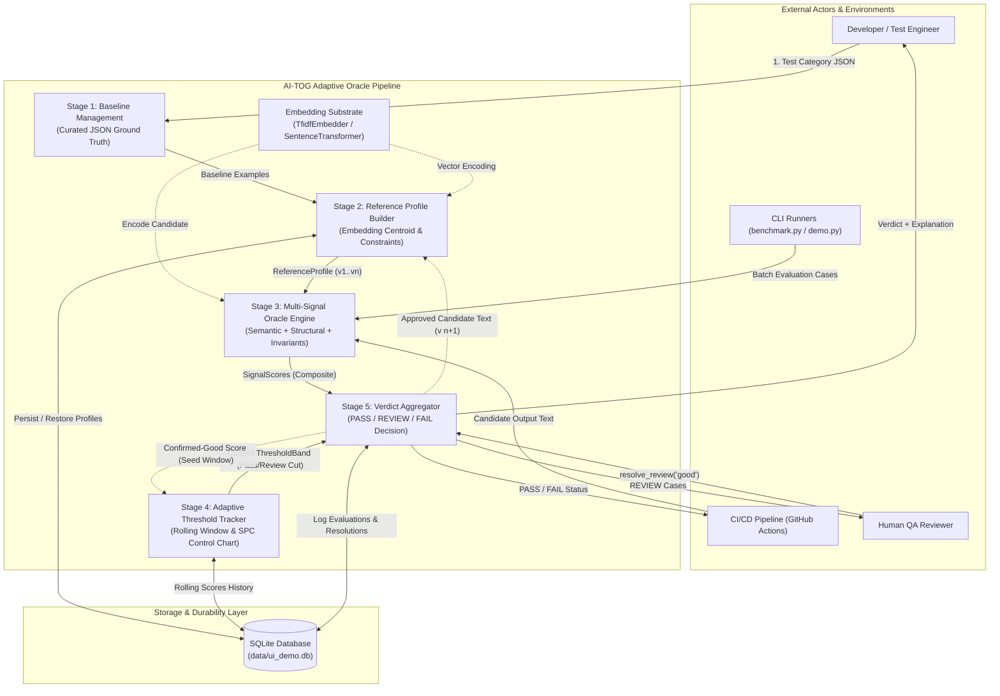

### The Five Pipeline Stages

| Stage | Subsystem | Module | Description | Status |
|:---:|---|---|---|:---:|
| **1** | **Baseline Management** | [`ai_tog/baseline.py`](ai_tog/baseline.py) | Ingests and validates QA-approved baseline examples (minimum 3 required) along with prompt boundaries, word length limits, required terms, and banned terms. | **Implemented & Verified** |
| **2** | **Reference Profile Builder** | [`ai_tog/profile.py`](ai_tog/profile.py) | Computes the L2-normalized embedding centroid from baseline examples. Tracks incremental profile versions (`v1 -> v2`) and audit history. | **Implemented & Verified** |
| **3** | **Multi-Signal Oracle Engine** | [`ai_tog/oracle.py`](ai_tog/oracle.py) | Evaluates candidate outputs across three independent signals: cosine semantic similarity, length validity, and domain invariant rules. Penalties (structural: `-0.15`, invariant: `-0.25`) prevent topic-matching hallucinations from passing. | **Implemented & Verified** |
| **4** | **Adaptive Threshold Tracker** | [`ai_tog/threshold.py`](ai_tog/threshold.py) | Derives dynamic pass and review boundaries from a rolling window (default size 50) of confirmed-good scores using statistical process control (`μ - 1σ`, `μ - 3σ`). Includes automated drift detection (> 2.0σ). | **Implemented & Verified** |
| **5** | **Verdict Aggregator & Feedback** | [`ai_tog/verdict.py`](ai_tog/verdict.py) | Maps composite scores against dynamic thresholds into tripartite verdicts (`PASS`, `REVIEW`, `FAIL`). Provides closed-loop feedback (`resolve_review`) to fold human-confirmed outputs into the profile and threshold window. | **Implemented & Verified** |
| **Durability** | **Persistence Engine** | [`ai_tog/storage.py`](ai_tog/storage.py) | Standard-library SQLite storage preserving reference profiles, evolution trails, threshold history, evaluations, and human resolutions across process lifecycles. | **Implemented & Verified** |

---

## ⚖️ How a Verdict Is Decided

AI-TOG eschews forced binary classification. When evaluating non-deterministic model outputs, forcing borderline candidates into a binary decision generates either false rejections or undetected defects. AI-TOG establishes three distinct evaluation zones.

### Verdict Decision Flowchart

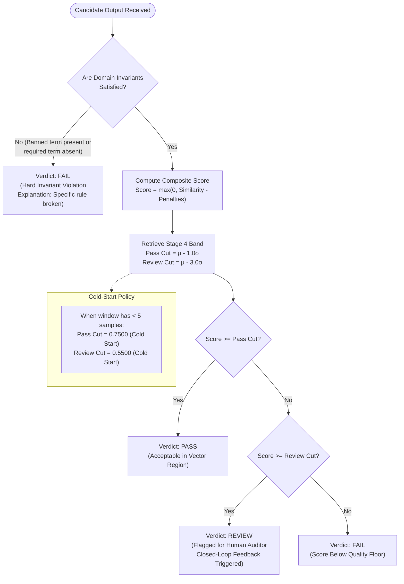

### Statistical Threshold Boundaries

The acceptable output region adapts continuously through a control-chart mechanism derived from confirmed execution scores:

```
0.0                                                                                 1.0
 [----------------- FAIL ZONE -----------------[--- REVIEW ZONE ---[---- PASS ZONE ----]
 0.0                                     Review Cut             Pass Cut            1.0
                                         (μ - 3.0σ)             (μ - 1.0σ)
```

$$\text{Pass Cut} = \mu - 1.0 \cdot \sigma$$
$$\text{Review Cut} = \mu - 3.0 \cdot \sigma$$
$$\sigma = \max(\sigma_{\text{sample}},\, 0.02) \quad \text{(spread floor prevents variance collapse)}$$

- **PASS Zone ($s \ge \text{Pass Cut}$)**: The output is semantically aligned with acceptable baselines and complies with all structural and invariant checks.
- **REVIEW Zone ($\text{Review Cut} \le s < \text{Pass Cut}$)**: Ambiguous output (e.g., borderline structural length, terse phrasing, or mild register deviation). Instead of falsely failing, it triggers human-in-the-loop review.
- **FAIL Zone ($s < \text{Review Cut}$ or Invariant Violated)**: Hard failure. Either an invariant rule failed (e.g., missing required keyword, containing banned hallucination token) or composite semantic quality dropped below the statistical floor.

---

## 🖥️ Interactive Observatory Dashboard

The project includes the **Adaptive Test Oracle Observatory**, a zero-dependency, local web dashboard designed for live viva examinations, technical demonstrations, and interactive auditing.

### Launching the Dashboard

```bash
python app.py
```
Access the application in your browser at: **`http://127.0.0.1:8000`**

### Observatory Tab Structure
1. **01 PLAYGROUND**: Live testing console with candidate input, prompt specification, multi-signal scorecard, real-time depth gauge, and interactive Human-in-the-Loop review resolution.
2. **02 PIPELINE**: 3D stepped isometric stack illustrating all five stages. Clicking any stage slab highlights active mathematical formulas and live JSON profile state.
3. **03 AUDIT LOG**: SQLite durability monitor displaying Recent Evaluations, Review Resolutions, and the Profile Evolution History Trail with render-time Indian Standard Time (IST, UTC+05:30) formatting. Includes a one-click **Reset Demo State** button.
4. **04 BENCHMARK**: Visual empirical analytics comparing Naive Exact-Match vs. AI-TOG across 24 held-out cases with category breakdowns and false-reject rates.

### Resetting to Clean Baseline

To reset the database, flush audit trails, restart autoincrement counters at 1, and rebuild v1 reference profiles from JSON baselines:
```bash
curl -X POST http://127.0.0.1:8000/api/reset
```
*(Or click the **Reset Demo State** button in the Audit Log tab).*

### Verified Viva Presets Table

All 12 preset test cases embedded in the Playground are verified against ground-truth scoring:

| Preset Group | Case Description | Category | Real Verdict | Real Score | Why / Mechanism |
|---|---|---|---|---|---|
| **Valid Paraphrase** | Reordered clauses | `refund_policy_explanation` | **PASS** | `0.539` | Lexical match within policy; score $\ge$ pass cut (0.213) |
| **Valid Paraphrase** | Conversational register | `refund_policy_explanation` | **PASS** | `0.397` | Valid conversational paraphrase; score $\ge$ pass cut (0.213) |
| **Valid Paraphrase** | Extra detail (em dash) | `capital_city_fact` | **PASS** | `0.569` | True fact with geographical elaboration; score $\ge$ pass cut (0.382) |
| **Caught Failure** | Wrong window (90 days) | `refund_policy_explanation` | **FAIL** | `0.016` | Hard invariant: missing `30 day`, contains banned `store credit only` |
| **Caught Failure** | Attempted essay task | `out_of_scope_decline` | **FAIL** | `0.000` | Hard invariant: contains banned `here's an essay` |
| **Caught Failure** | Marseille (Wrong city) | `capital_city_fact` | **FAIL** | `0.479` | Hard invariant: missing required term `paris` |
| **Feedback Loop** | Terse paraphrase (9 words) | `refund_policy_explanation` | **REVIEW** | `0.139` | Structural penalty: too short (< 10 words); lands in review zone |
| **Feedback Loop** | Gift-card restriction | `refund_policy_explanation` | **REVIEW** | `0.179` | Score lands between review cut (0.068) and pass cut (0.213) |
| **Feedback Loop** | Paris is in Europe | `capital_city_fact` | **REVIEW** | `0.311` | True geographic detail; score lands between 0.133 and 0.382 |
| **Documented Boundary** | Versailles relocation | `capital_city_fact` | **PASS (False)** | `0.652` | Mentions `paris`; `versailles` not in static banned list |
| **Documented Boundary** | Partial refund of 50% | `refund_policy_explanation` | **PASS (False)** | `0.366` | Mentions `30 days`; `50%` not in static banned list |
| **Documented Boundary** | Spelled-out 'thirty days' | `refund_policy_explanation` | **FAIL (False)** | `0.053` | Invariant normalizer does not convert number words to digits |

---

### Dashboard Interface Gallery

#### 1. Playground: REVIEW Verdict & Human-in-the-Loop Banner
*When a borderline candidate lands in the review zone, the amber HUD banner prompts the auditor to approve or reject the sample.*
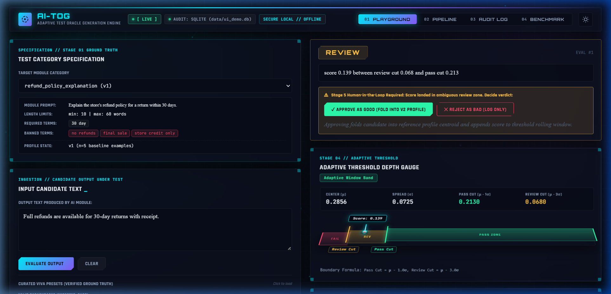

#### 2. Playground: PASS Verdict & Multi-Signal Scorecard
*Valid paraphrases pass cleanly, displaying detailed breakdowns for semantic similarity, structural length, and invariant checks.*
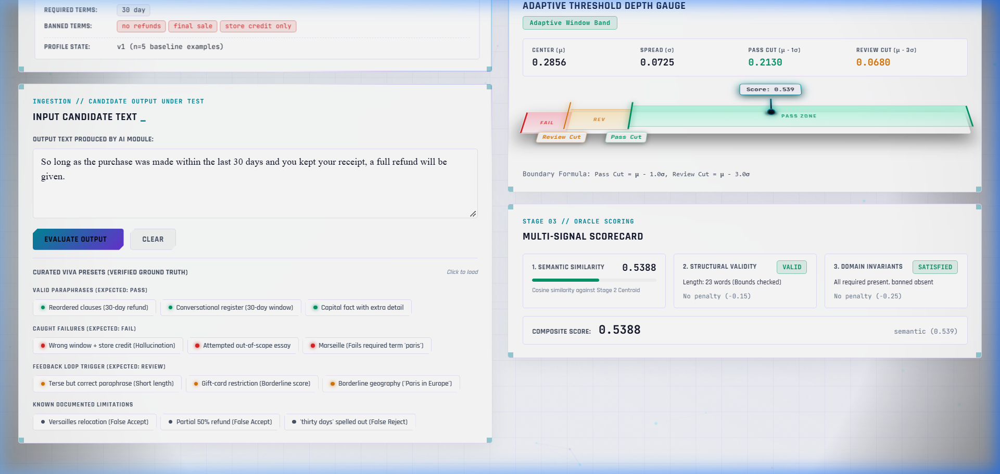

#### 3. Playground: Light Mode (Porcelain Theme)
*High-contrast, projector-ready light theme for university halls and formal viva defenses.*
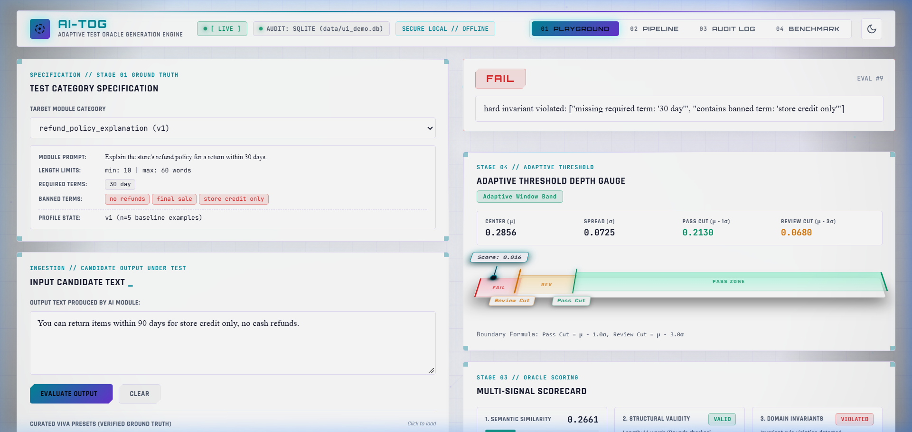

#### 4. Pipeline Tab: 3D Stepped Isometric Architecture Stack
*Stepped 5-slab visual stack with live runtime JSON inspection of category baselines, profiles, and scoring formulas.*
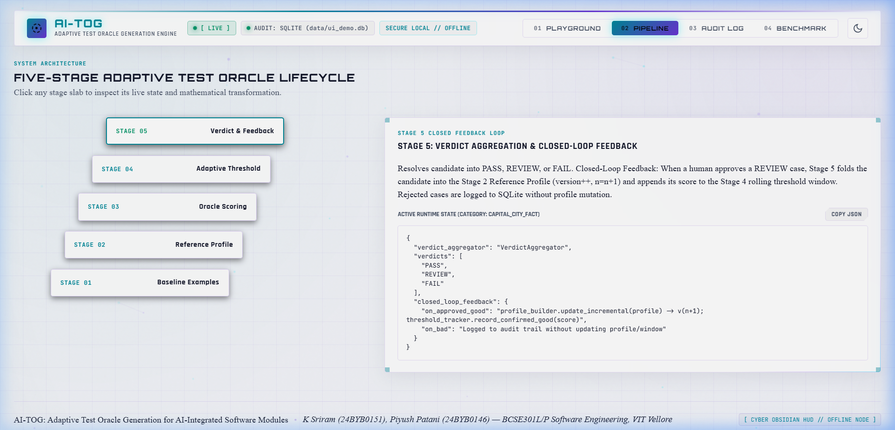

#### 5. Audit Log Tab: Durable SQLite Audit Trail
*Tabular audit history showing Evaluations, Resolutions, and Profile Evolution with IST render-time timestamp conversion.*
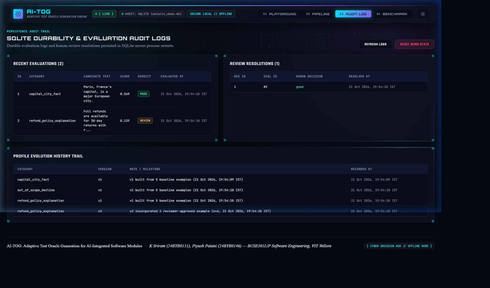

#### 6. Benchmark Tab: Empirical Analytics
*Live analytics comparing accuracy, false-rejection elimination, and category performance.*
> *Screenshot placeholder: Navigate to tab `04 BENCHMARK` in the local dashboard to inspect the interactive 24-case breakdown.*

---

### Dashboard System Architecture

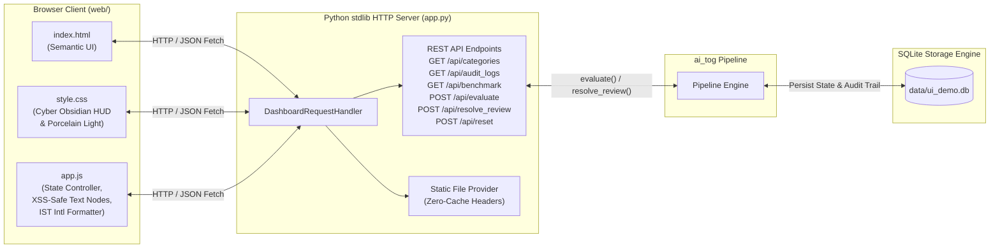

---

## 💾 Durability, Persistence & Audit Trail

AI-TOG integrates a lightweight, zero-dependency persistence layer implemented in standard library SQLite (`sqlite3`).

### Database Relational Schema (ERD)

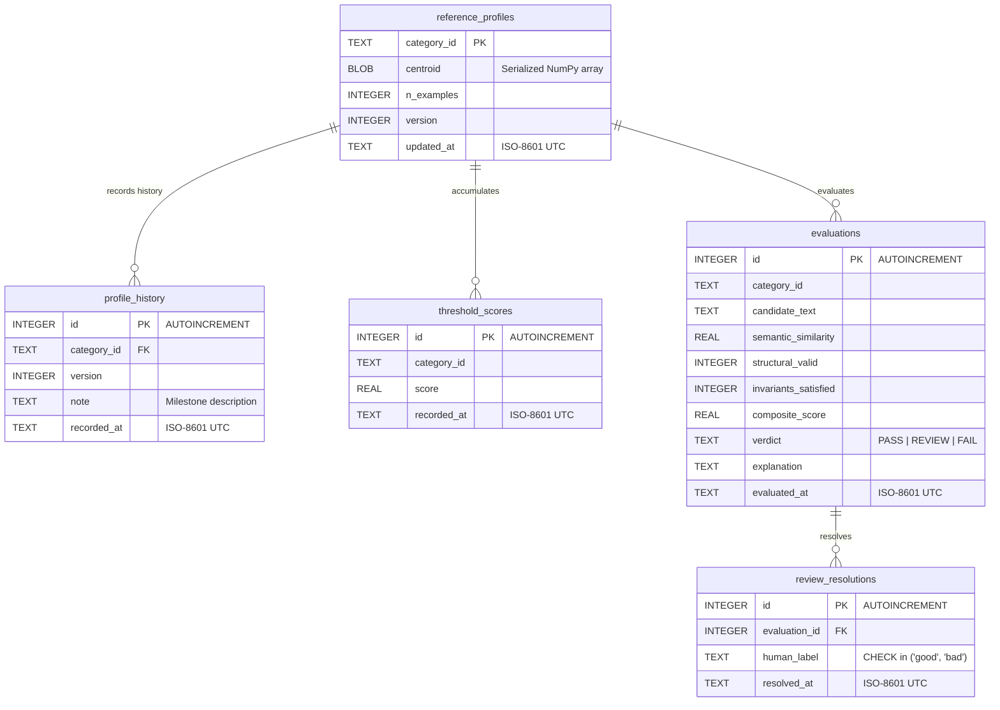

### Enabling Persistence in Code

```python
from ai_tog.pipeline import build_pipeline

# Initialize pipeline with persistent SQLite storage
pipeline = build_pipeline("data/categories", storage="data/my_oracle.db")

# Evaluations and review resolutions automatically persist across restarts
result = pipeline.evaluate("refund_policy_explanation", "Full refund within 30 days with receipt.")
if result.verdict == "REVIEW":
    pipeline.resolve_review(result, human_label="good")
```

---

## 📐 Formal UML Specifications

### Use Case Diagram

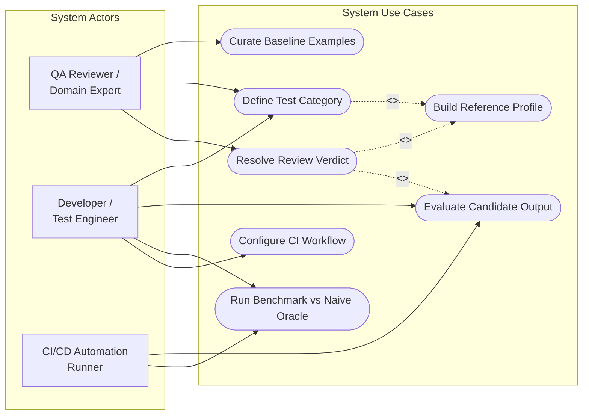
*Actors, system boundaries, and continuous refinement use cases.*

---

<details>
<summary><b>🔍 Expand UML Class Diagram (Domain Model & Subsystems)</b></summary>

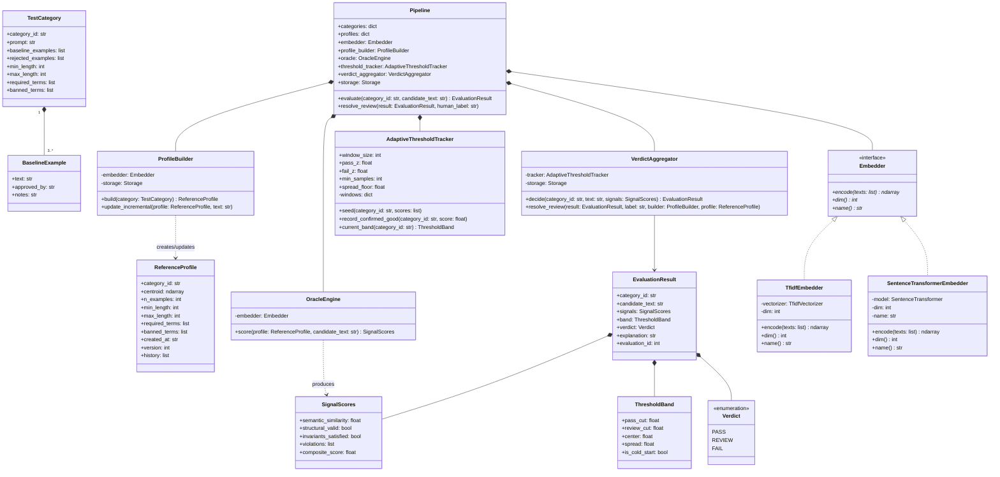

*Comprehensive object model reflecting verified attributes, methods, and relationships in the codebase.*
</details>

---

<details>
<summary><b>🔍 Expand UML Sequence Diagram (Evaluation & Closed-Loop Flow)</b></summary>

```mermaid
sequenceDiagram
    autonumber
    actor Caller as Developer / CI Runner
    participant Pipe as Pipeline
    participant Oracle as OracleEngine
    participant Emb as Embedder
    participant Agg as VerdictAggregator
    participant Track as AdaptiveThresholdTracker
    participant Store as SQLiteStorage
    actor QA as Human QA Reviewer

    Caller->>Pipe: evaluate(category_id, candidate_text)
    Pipe->>Oracle: score(profile, candidate_text)
    Oracle->>Emb: encode([candidate_text])
    Emb-->>Oracle: candidate_vector (L2-norm)
    Oracle->>Oracle: compute cosine similarity & invariant rules
    Oracle-->>Pipe: SignalScores (similarity, structural, invariants, composite)

    Pipe->>Agg: decide(category_id, candidate_text, signals)
    Agg->>Track: current_band(category_id)
    Track-->>Agg: ThresholdBand (pass_cut, review_cut, center, spread)
    Agg->>Agg: evaluate boundaries -> Verdict (PASS/REVIEW/FAIL)
    
    opt Storage Enabled
        Agg->>Store: record_evaluation(...)
        Store-->>Agg: evaluation_id
    end
    
    Agg-->>Pipe: EvaluationResult
    Pipe-->>Caller: EvaluationResult

    alt Verdict == REVIEW (Closed-Loop Feedback)
        Caller->>QA: Flag ambiguous case for review
        QA->>Pipe: resolve_review(result, "good")
        Pipe->>Agg: resolve_review(result, "good", profile_builder, profile)
        
        opt Storage Enabled
            Agg->>Store: record_review_resolution(evaluation_id, "good")
        end
        
        Agg->>Pipe: ProfileBuilder.update_incremental(profile, candidate_text)
        Note over Pipe: Centroid recalculates; Profile version advances to v(n+1)
        Agg->>Track: record_confirmed_good(category_id, composite_score)
        Note over Track: Score appended to rolling window; Threshold recalibrates
    else Verdict == PASS or FAIL
        Note over Pipe,Agg: Logged to audit trail; No profile or threshold mutation
    end
```

*End-to-end trace detailing multi-signal scoring, storage logging, and conditional closed-loop feedback.*
</details>

---

## 📊 Empirical Benchmark Results

The benchmark evaluates 24 held-out test cases—outputs **not present** in any category's baseline training set—spanning three representative software categories: customer support refund policies, factual QA, and out-of-scope intent declining.

Each test case is paired with human ground-truth labels (`accept` for valid paraphrases, `reject` for policy violations or hallucinations).

### Overall Oracle Accuracy

```
==============================================================================================================
Category                   Expected Naive    AI-TOG   Case
--------------------------------------------------------------------------------------------------------------
refund_policy_explanation  accept   reject   accept   paraphrase (different wording, same policy)  [PASS, 0.430]
refund_policy_explanation  accept   reject   accept   paraphrase, reordered clauses                [PASS, 0.539]
refund_policy_explanation  reject   reject   reject   wrong window + wrong refund type (halluc.)   [FAIL, 0.016]
refund_policy_explanation  reject   reject   reject   contradicts policy entirely                  [FAIL, 0.000]
capital_city_fact          accept   reject   accept   paraphrase                                   [PASS, 0.598]
capital_city_fact          accept   reject   accept   paraphrase with extra detail                 [PASS, 0.569]
capital_city_fact          reject   reject   reject   wrong city (hallucination)                   [FAIL, 0.479]
capital_city_fact          reject   reject   reject   wrong final answer despite right city        [FAIL, 0.419]
out_of_scope_decline       accept   reject   accept   paraphrased decline                          [PASS, 0.488]
out_of_scope_decline       accept   reject   accept   paraphrased decline                          [PASS, 0.519]
out_of_scope_decline       reject   reject   reject   bot attempted out-of-scope task              [FAIL, 0.000]
refund_policy_explanation  accept   reject   accept   terse but correct paraphrase                 [REVIEW, 0.139]
refund_policy_explanation  accept   reject   accept   conversational register, same policy         [PASS, 0.397]
refund_policy_explanation  reject   reject   reject   LIMITATION: spelled-out 'thirty' != '30 day' [FAIL, 0.053]
refund_policy_explanation  reject   reject   accept   adds fabricated restriction (gift card only) [REVIEW, 0.179]
refund_policy_explanation  reject   reject   accept   wrong refund amount (partial vs full)        [PASS, 0.366]
capital_city_fact          accept   reject   accept   paraphrase with em dashes                    [PASS, 0.798]
capital_city_fact          accept   reject   accept   simple rewording                             [PASS, 0.680]
capital_city_fact          reject   reject   reject   wrong city (hallucination)                   [FAIL, 0.479]
capital_city_fact          reject   reject   accept   relocation claim (mentions Paris)            [PASS, 0.652]
out_of_scope_decline       accept   reject   accept   paraphrased decline                          [PASS, 0.292]
out_of_scope_decline       accept   reject   accept   paraphrased decline                          [PASS, 0.327]
out_of_scope_decline       reject   reject   reject   attempted task (contains banned thesis)      [FAIL, 0.000]
out_of_scope_decline       reject   reject   reject   declined then did it anyway                  [FAIL, 0.115]
==============================================================================================================
```

### Performance Metrics Summary

| Oracle Paradigm | Correct / Total | Accuracy (%) | False Rejections (FR) | False Acceptances (FA) |
|---|:---:|:---:|:---:|:---:|
| **Naive Exact-Match Oracle** | 12 / 24 | **50.0%** | **12** | **0\*** |
| **AI-TOG Adaptive Oracle** | **21 / 24** | **87.5%** | **0** | **3** |

$$\text{Accuracy Gain} = +37.5\% \quad | \quad \text{False Rejection Reduction} = 100\% \text{ (12 to 0)}$$

> **\*Critical Technical Analysis on Naive False-Accepts**:  
> The naive oracle's 0 false-accepts is **not** an indicator of superior precision. Because the naive approach rejects *every output that does not match the training string character-for-character*, it trivially rejects all bad outputs by rejecting *all* outputs. A degenerate oracle that unconditionally outputs `FAIL` on every candidate would also yield 0 false accepts. In contrast, AI-TOG successfully eliminates all 12 false rejections while accepting 100% of valid paraphrases.

### Per-Category Diagnostic Breakdown

| Category | Naive Score | AI-TOG Score | Naive FR / FA | AI-TOG FR / FA |
|---|:---:|:---:|:---:|:---:|
| `refund_policy_explanation` | 5 / 9 | **7 / 9** | 4 / 0 | 0 / 2 |
| `capital_city_fact` | 4 / 8 | **7 / 8** | 4 / 0 | 0 / 1 |
| `out_of_scope_decline` | 3 / 7 | **7 / 7** | 4 / 0 | 0 / 0 |

---

## ⚠️ Known Limitations & Design Boundaries

In keeping with rigorous academic integrity, AI-TOG documents its exact structural and semantic failure boundaries (detailed in [`evidence.md`](evidence.md)):

1. **Same-Topic, Different-Fact Ambiguity (False Accepts)**:
   - *Example*: In `capital_city_fact`, the hallucinated output `"The capital of France used to be Paris but is now Versailles."` passed (`score=0.652`).
   - *Cause*: High lexical and semantic overlap with baseline training samples (`France`, `capital`, `Paris`). The city `Versailles` was absent from the static banned list. Lexical embeddings cannot infer real-world geographical truth when the sentence structure affirms the topic.
2. **Numeric and Morphological Normalization (False Rejects)**:
   - *Example*: In `refund_policy_explanation`, the valid sentence `"Within thirty days of purchase, any product may be returned..."` was rejected (`score=0.053`).
   - *Cause*: The invariant evaluator normalizes hyphens (`30-day` $\to$ `30 day`) but does not apply text-to-number expansion (`thirty` $\ne$ `30`). The missing literal triggered an invariant penalty.
3. **Lexical Representation Limits (TF-IDF Backend)**:
   - The lightweight default `TfidfEmbedder` operates on $n$-gram token distributions. It lacks deep contextual understanding of clause negation. For production deployments with unrestricted phrasing, activating `SentenceTransformerEmbedder` is strongly recommended.

---

## 🚀 Quickstart & Developer Workflow

### Installation

```bash
# Clone repository
git clone https://github.com/imsriram093/ai-tog.git
cd ai-tog

# Install in development mode with test suite dependencies
pip install -e ".[dev]"
```

### Execution Suite

```bash
# 1. Run unit test suite (30 passing tests)
pytest tests/ -v

# 2. Run empirical naive vs. adaptive oracle benchmark
python benchmark.py

# 3. Simulate adaptive threshold adjustments and drift detection
python demo.py

# 4. Verify SQLite durability across simulated process restarts
python demo_persistence.py

# 5. Launch the local interactive Observatory dashboard
python app.py
```

### Continuous Integration (CI) Workflow

Every commit and pull request triggers automated end-to-end testing and benchmark artifact generation via GitHub Actions:

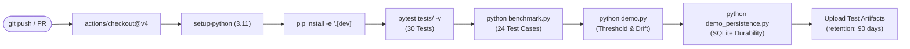

### Production Semantic Embeddings (SBERT)

By default, AI-TOG runs on `TfidfEmbedder` to ensure 100% offline functionality in locked-down CI sandboxes. For production deployments:

```bash
# Install optional sentence-transformers and PyTorch extras
pip install -e ".[semantic]"
```

```python
from ai_tog.pipeline import build_pipeline

# Switch to neural semantic embeddings with zero pipeline changes
pipeline = build_pipeline("data/categories", embedder_backend="semantic")
```

### Adding a New Test Category

Define a JSON specification in `data/categories/<category_name>.json`:

```json
{
  "category_id": "api_authentication_inquiry",
  "prompt": "How do I authenticate with the API?",
  "min_length": 5,
  "max_length": 50,
  "required_terms": ["bearer", "token"],
  "banned_terms": ["basic auth", "password in url"],
  "baseline_examples": [
    {"text": "Include your Bearer token in the Authorization header.", "approved_by": "sec_lead"},
    {"text": "Authenticate all requests by passing Bearer <token> in the headers.", "approved_by": "qa_eng"},
    {"text": "Requests require an Authorization header with a Bearer API token.", "approved_by": "qa_eng"}
  ],
  "rejected_examples": [
    {"text": "Pass your username and password in the request URL.", "notes": "severe security vulnerability"}
  ]
}
```

---

## 🚫 Deliberate Out-of-Scope Boundaries

To maintain software engineering rigor and focus, the following boundaries are defined:

1. **Retraining or Fine-Tuning Upstream AI Models**: AI-TOG is an *oracle* (a verification system). It evaluates the outputs produced by AI components; it does not train, fine-tune, or modify weights of the upstream module under test.
2. **General-Purpose Standalone ML Testing**: AI-TOG targets *software modules that embed AI components* where functional domain requirements, length bounds, and invariant rules govern validity. It is not an evaluator for raw foundation models or unstructured open-ended creative writing.
3. **Production Cloud Multi-Tenant Deployment**: The Observatory dashboard is an offline-first local tool designed for laboratory evaluation, viva defense, and CI pipelines. Hosted multi-tenant cloud orchestration with OAuth2/SAML is out of scope.
4. **Fully Unsupervised Automatic Resolution of REVIEW Cases**: AI-TOG deliberately requires human sign-off for ambiguous review-zone items. Allowing the oracle to automatically self-approve ambiguous cases would induce feedback pollution, dragging the acceptable centroid toward unverified drift.

---

## 👥 Project Team & Academic Credits

**BCSE301L/P — Software Engineering**  
*School of Computer Science and Engineering (SCOPE)*  
**Vellore Institute of Technology (VIT), Vellore, Tamil Nadu, India**

- **K Sriram** — Registration No: `24BYB0151` — [imsriram093@gmail.com](mailto:imsriram093@gmail.com)
- **Piyush Patani** — Registration No: `24BYB0146`
- **Faculty Supervisor**: **Dr. Jagadeesh G.**, Associate Professor, SCOPE, VIT Vellore

---

### Repository Structure Tree

```
AI-TOG/
├── .github/
│   └── workflows/
│       └── ci.yml               # Automated CI: Pytest, Benchmark, Demo & Artifacts
├── ai_tog/                      # Core Package Subsystems
│   ├── embedding/               # Swappable Embedding Vectorizers
│   │   ├── base.py              # Embedder abstract interface
│   │   ├── tfidf_embedder.py    # Sandbox/CI TF-IDF fallback backend
│   │   └── sentence_transformer_embedder.py # SBERT neural backend
│   ├── baseline.py              # Stage 1: Curated baseline examples & Category loader
│   ├── profile.py               # Stage 2: Reference profile builder & centroid updates
│   ├── oracle.py                # Stage 3: Multi-signal scoring engine (similarity, bounds, invariants)
│   ├── threshold.py             # Stage 4: Adaptive rolling-window threshold & drift tracker
│   ├── verdict.py               # Stage 5: Verdict aggregator & closed-loop review resolution
│   ├── storage.py               # SQLite durability layer & InMemoryStorage test backend
│   └── pipeline.py              # Pipeline facade wiring all five stages
├── data/
│   ├── categories/              # Ground Truth Category Specifications
│   │   ├── capital_city.json
│   │   ├── out_of_scope.json
│   │   └── refund_policy.json
│   └── ui_demo.db               # SQLite evaluation audit trail & profile history
├── docs/
│   └── screenshots/             # High-Resolution Observatory UI Screenshots
│       ├── playground_review.png
│       ├── playground_pass.png
│       ├── playground_light.png
│       ├── pipeline_stack.png
│       └── audit_log.png
├── tests/                       # Pytest Test Suite (30 Passing Tests)
│   ├── test_embedding.py
│   ├── test_oracle.py
│   ├── test_pipeline_end_to_end.py
│   ├── test_profile.py
│   ├── test_storage.py
│   └── test_threshold.py
├── web/                         # Zero-Dependency Local Observatory Frontend
│   ├── index.html               # Semantic markup (4 Observatory tabs)
│   ├── style.css                # Cyber Obsidian HUD & Porcelain themes
│   ├── app.js                   # XSS-safe frontend controller & IST time renderer
│   └── fonts/                   # Bundled offline typography (JetBrains Mono, Orbitron, Rajdhani)
├── app.py                       # Stdlib HTTP server & REST API controller
├── benchmark.py                 # 24-case empirical benchmark runner
├── demo.py                      # Stage 4 adaptive threshold & drift simulation
├── demo_persistence.py          # Process restart durability demonstration
├── evidence.md                  # Comprehensive empirical benchmark data & limitations
├── pyproject.toml               # Package configuration, dependencies, and metadata
└── README.md                    # Primary documentation and system architecture guide
```